# Benchmark-Algorithms-Sorting
Name : عبد المعين فرج المرامي
Student ID : 3153018

This project benchmarks several sorting algorithms using different input scenarios to compare their performance and verify correctness.

English: The program creates sorted, reverse-sorted, partially sorted, and random arrays, then measures how long each sorting algorithm takes to process them.
Arabic: ينشئ هذا البرنامج مصفوفات مرتبة ومرتبة ترتيباً عكسياً ومرتبة جزئياً وعشوائية، ثم يقيس الوقت الذي تستغرقه كل خوارزمية فرز لمعالجة تلك البيانات.

## Benchmark results

Results from the latest run (time in microseconds):

| Algorithm | Sorted | Reverse | Partial | Random |
|---|---:|---:|---:|---:|
| Selection Sort | 1,417,768 | 5,108,022 | 2,534,388 | 2,523,922 |
| Insertion Sort | 1,888 | 6,681,888 | 545,433 | 1,779,466 |
| Bubble Sort | 1,853 | 8,034,224 | 8,242,685 | 16,856,373 |
| Merge Sort | 16,430 | 55,391 | 7,767 | 14,543 |
| Quick Sort | 27,389 | 18,526 | 11,500 | 13,493 |

### Benchmark chart

```mermaid
xychart-beta
    title "Sorting Algorithm Benchmark by Scenario (microseconds)"
    x-axis ["Selection", "Insertion", "Bubble", "Merge", "Quick"]
    y-axis "Time (microseconds)" 0 --> 17000000
    bar "Sorted" [1417768, 1888, 1853, 16430, 27389]
    bar "Reverse" [5108022, 6681888, 8034224, 55391, 18526]
    bar "Partial" [2534388, 545433, 8242685, 7767, 11500]
    bar "Random" [2523922, 1779466, 16856373, 14543, 13493]
```

Note: Timing results depend on the machine and runtime environment, so repeated runs may produce different values.

English: Each algorithm is tested against the same four input scenarios. The benchmark copies each original array before sorting and checks that the result is in ascending order.
Arabic: يتم اختبار كل خوارزمية باستخدام سيناريوهات الإدخال الأربعة نفسها. تنسخ المقارنة كل مصفوفة أصلية قبل الفرز، ثم تتحقق من أن النتيجة مرتبة تصاعدياً.

## Sorting algorithms included

- Selection Sort
- Insertion Sort
- Bubble Sort
- Merge Sort
- Quick Sort
