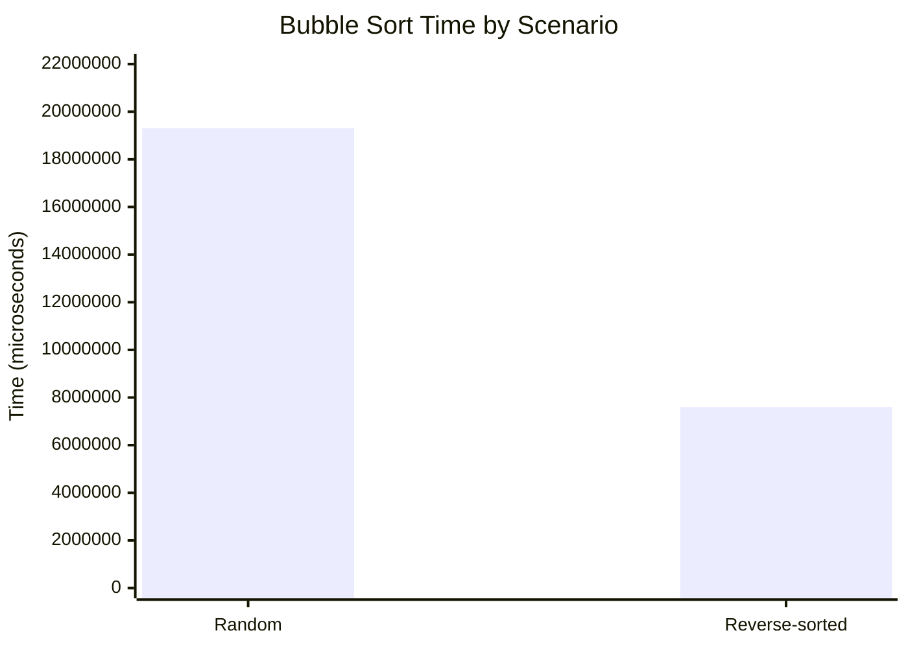

# Benchmark-Algorithms-Sorting
Name : عبد المعين فرج المرامي
Student ID : 3153018

This project benchmarks several sorting algorithms using different input scenarios to compare their performance and verify correctness.

English: The program creates sorted, reverse-sorted, partially sorted, and random arrays, then measures how long each sorting algorithm takes to process them.
Arabic: ينشئ هذا البرنامج مصفوفات مرتبة ومرتبة ترتيباً عكسياً ومرتبة جزئياً وعشوائية، ثم يقيس الوقت الذي تستغرقه كل خوارزمية فرز لمعالجة تلك البيانات.

## Benchmark results

The benchmark values below reflect the current timings captured from the project execution:

| Scenario | Time (microseconds) |
|---|---:|
| Random array | 19,308,905.708 |
| Reverse-sorted array | 7,602,108.173 |

```text
Algorithm             Scenario        Time (microseconds)
Bubble Sort           Random          19,308,905.708
Bubble Sort           Reverse-sorted  7,602,108.173
```



English: In this run, the reverse-sorted dataset was faster than the random dataset by 11,706,797.535 microseconds.
Arabic: في هذا التشغيل، كانت البيانات المرتبة ترتيباً عكسياً أسرع من البيانات العشوائية بمقدار 11,706,797.535 ميكروثانية.

## Notes

English: The output is generated by the benchmark logic in `SortingBenchmark.java`, which uses the same input for each algorithm and checks whether the sorted result is valid before printing the runtime.
Arabic: يتم إنتاج هذا الناتج من خلال منطق المقارنة في ملف `SortingBenchmark.java`، الذي يستخدم نفس الإدخال لكل خوارزمية ويؤكد أن النتيجة المرتبة صحيحة قبل طباعة وقت التنفيذ.

## Sorting algorithms included

- Selection Sort
- Insertion Sort
- Bubble Sort
- Merge Sort
- Quick Sort

English: Each algorithm is tested under the same four scenarios to keep the comparison fair. This gives a practical view of algorithm behavior on real-world input patterns.
Arabic: يتم اختبار كل خوارزمية ضمن نفس السيناريوهات الأربعة للحفاظ على العدالة في المقارنة، مما يمنح نظرة عملية على سلوك الخوارزميات عند أنواع مختلفة من المدخلات.
